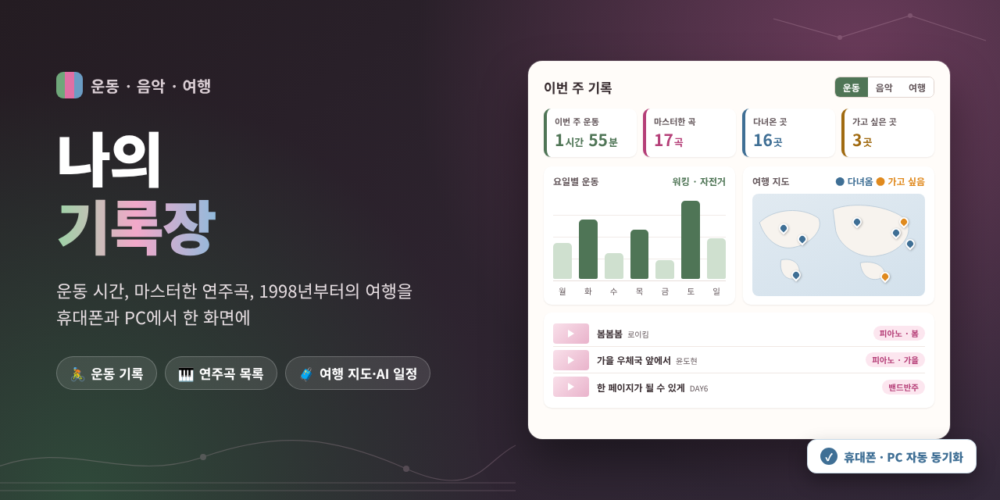

# 나의 기록장



운동 시간, 직접 연습해서 마스터한 연주곡, 1998년부터의 여행 기록을 한 곳에서 관리하는 개인용 웹사이트입니다. 휴대폰에서 바로 입력하고 PC에서 정리·조회하며, 로그인하면 두 기기의 기록이 자동으로 맞춰집니다. 요구사항은 [BRD.md](BRD.md), [PRD.md](PRD.md)를 참고하세요.

- 사이트: https://realrose79-art.github.io/jjang-site/
- AI 기능 서버: https://jjang-site.vercel.app

## 주요 기능
1. **나의 운동:** 날짜·분류(워킹·자전거·수영)·시간 기록, 오늘/이번 주/이번 달 합계, 요일별 막대그래프
2. **나의 음악:** 마스터한 곡을 카드로 정리, 유튜브 연주 영상 재생, 구글드라이브 악보 바로 열기
3. **나의 여행:** 다녀왔어요 / 가고 싶어요 두 목록, 지도 핀, 사진·블로그 링크, 가고 싶어요 → 다녀왔어요 이동
4. **여행 AI 일정:** 대화로 여행 일정을 보완하고 저장 (Gemini, Vercel 서버 함수 경유)
5. **공통:** 2단계 카테고리 편집, 백업 저장·불러오기, 다크 모드, 휴대폰·PC 화면 대응

## 실행 방법
빌드나 설치가 필요 없는 정적 웹페이지입니다. `index.html`을 브라우저로 열면 동작합니다.

일부 기능(위치 검색, 유튜브 카드 안 재생)은 파일로 열면(file://) 막힐 수 있으니, 로컬에서 확인할 때는 간단한 서버로 여는 것을 권장합니다.

```bash
python -m http.server 8765 --bind 127.0.0.1
```

브라우저에서 http://localhost:8765 를 엽니다.

## 로그인과 데이터 저장
- 기록은 Supabase에 저장되고, 이메일+비밀번호로 로그인합니다.
- 로그인하지 않으면 **조회만** 가능하고, 입력·수정·삭제와 AI 대화는 로그인해야 합니다.
- 테이블마다 행 수준 보안(RLS)이 걸려 있어 로그인한 본인의 기록만 읽고 쓸 수 있습니다.
- 다른 기기에서 바뀐 내용은 15초마다, 그리고 화면으로 돌아올 때 자동으로 가져옵니다.
- `config.js`에는 화면 코드에 들어가도 되는 **공개(publishable) 키만** 넣습니다. secret·service_role 키는 넣지 않습니다.

## AI 기능 설정 (Vercel)
Gemini API 키는 저장소에 넣지 않고 Vercel 환경 변수에만 둡니다.

| 환경 변수 | 필수 | 설명 |
|---|---|---|
| `GEMINI_API_KEY` | 예 | Gemini API 키 |
| `GEMINI_MODEL` | 아니요 | 기본값 `gemini-3.5-flash-lite` |

내 PC에서 확인할 때는 `.env.example`을 복사해 `.env`를 만들고 값을 채운 뒤 아래처럼 실행합니다 (Node 18 이상).

```bash
node tools/gemini.mjs --check
```

## 알아 둘 점
- 저장소가 공개이므로 `data.js`의 기본 데이터(연주곡·여행 목록)도 공개됩니다.
- 지도·썸네일·글꼴은 인터넷 연결이 필요합니다.
- 구글드라이브 악보·사진은 공유 설정이 "링크가 있는 모든 사용자"여야 보입니다.

## 폴더 구조
```
index.html            화면 틀
style.css             스타일
app.js                화면과 기능, Supabase 동기화
data.js               기본 데이터
ai-plans.js           여행 AI 일정 기본값
config.js             Supabase 공개 연결 정보
api/ai-plan.js        여행 일정 AI 서버 함수 (Vercel)
tools/gemini.mjs      Gemini 호출 도우미 (내 PC용)
assets/thumbnail.png  README 썸네일 (원본: assets/thumbnail.html)
BRD.md, PRD.md        요구사항 정리
```
